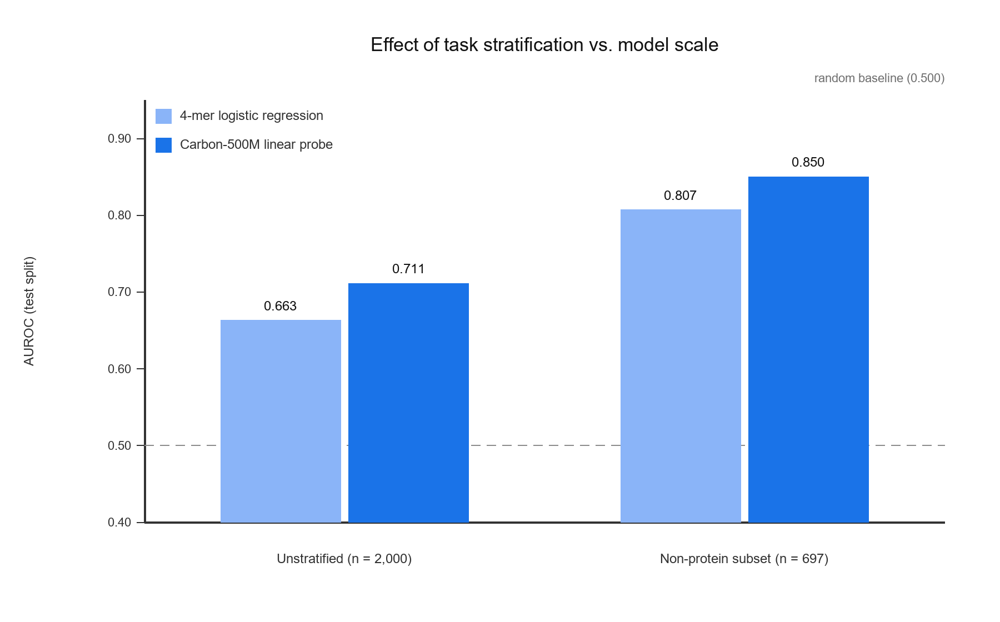
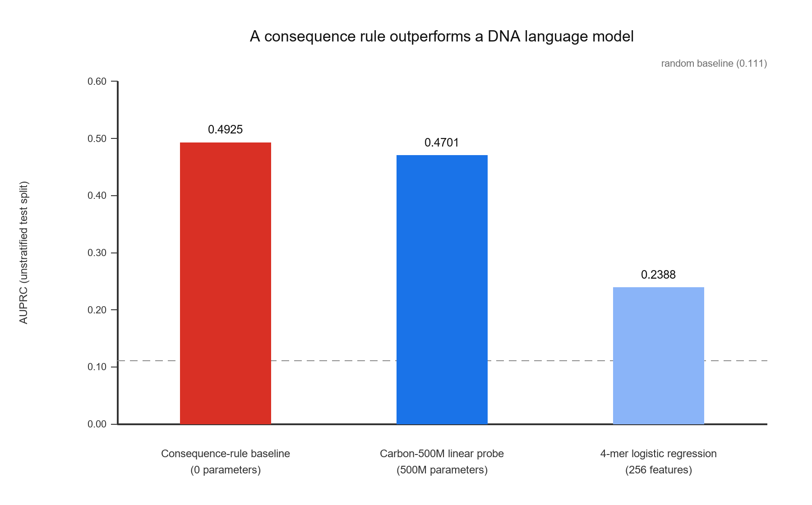

# ClinVar VEP Benchmark Audit

> An audit of a commonly used ClinVar variant-effect-prediction (VEP) evaluation set.
> We quantify how much of the reported metric comes from **task stratification**
> versus **model scale**, and show that the unstratified set is contaminated by
> protein-level consequences that a fixed-window DNA sequence model cannot resolve.

**Positioning.** This is a *benchmark audit* (diagnosis + metric attribution), **not** a new
industrial benchmark. The dataset is small (6,000 variants) and the pipeline is deliberately
lightweight. The contribution is the finding and the attribution, not the scale.

| Task stratification vs. model scale | A consequence rule outperforms a DNA LM |
|---|---|
|  |  |

---

## TL;DR — three findings

### 1. The unstratified evaluation set is contaminated by protein-level consequences

On the test split (222 positives / 1,778 negatives):

| Consequence class | Positives (n=222) | Negatives (n=1,778) |
|---|---|---|
| Non-protein (intronic / splice / UTR) | 64 (28.8%) | 633 (35.6%) |
| Synonymous | 1 (0.5%) | 953 (53.6%) |
| Missense | 77 (34.7%) | 192 (10.8%) |
| **Nonsense (stop-gained)** | **80 (36.0%)** | **0 (0.0%)** |

Why this matters:

- This dataset contains **single-nucleotide variants (SNVs) only**. An SNV cannot cause a
  frameshift (that requires an insertion/deletion); it truncates the protein by introducing a
  **premature stop codon**. The reported 36.0% are therefore nonsense/stop-gained variants.
- Such a variant's label is determined **entirely by its protein-level consequence**.
- Model inputs are **fixed-length windows of naked genomic sequence**, without transcript
  structure or CDS reading-frame phase. The frameshift/stop consequence is therefore
  **not recoverable from the input**.
- Such variants are also **trivially separable by consequence annotation** (VEP / SnpEff).
  Mixing them into the test set means the benchmark **no longer measures regulatory
  sequence modelling ability**.

**Direct evidence** — a consequence-rule baseline that uses *no sequence features at all*
("predict pathogenic if the HGVS indicates a premature stop codon") scores:

```
Consequence-rule baseline    AUPRC 0.4925
4-mer logistic regression    AUPRC 0.2388   (trained, 256 features)
```

### 2. Task stratification contributes more than model scale

| Comparison | AUROC change |
|---|---|
| Same model (4-mer LR), stratified task vs. unstratified | 0.663 → 0.807 (**+0.144**) |
| Same task, Carbon-500M probe vs. 4-mer LR | 0.807 → 0.850 (**+0.043**) |

The scaling gain is **the same size on both tasks** (+0.048 unstratified, +0.043 stratified),
i.e. model scale is an approximately *additive* improvement — so **contamination cannot be
compensated by scaling**.

### 3. AUPRC is not comparable across datasets with different positive rates

| Dataset | Positive rate | AUPRC | AUROC |
|---|---|---|---|
| Unstratified | 0.111 | 0.239 | 0.663 |
| Non-truncating | 0.074 | **0.231** | 0.678 |

Absolute AUPRC moves *with* the positive rate (an AUPRC random baseline **is** the positive
rate). Reporting AUPRC alone across datasets can invert the conclusion. **Always report AUROC
alongside AUPRC.**

---

## Results

Raw generated matrix: [`results_auto.md`](results_auto.md). Curated analysis: [`results.md`](results.md). Summary (test split):

| Dataset | Scorer | Pos. rate | AUROC | AUPRC | AUPRC / random |
|---|---|---|---|---|---|
| `vep_dataset` (unstratified) | random | 0.1110 | 0.489 | 0.112 | 1.01× |
| `vep_dataset` | GC content | 0.1110 | 0.535 | 0.122 | 1.10× |
| `vep_dataset` | 4-mer context (no ALT) | 0.1110 | 0.537 | 0.127 | 1.14× |
| `vep_dataset` | **4-mer difference** | 0.1110 | **0.663** | **0.239** | **2.15×** |
| `vep_dataset` | 4-mer difference, labels shuffled | 0.1110 | 0.511 | 0.126 | 1.14× |
| `vep_dataset_annot` | **consequence-rule baseline** | 0.1110 | **0.680** | **0.493** | **4.44×** |
| `vep_notrunc` (non-truncating) | 4-mer difference | 0.0740 | 0.678 | 0.231 | 3.13× |
| `vep_noprot` (non-protein) | 4-mer difference | 0.0918 | 0.807 | 0.352 | 3.83× |
| `vep_noprot` (non-protein) | **Carbon-500M probe** | 0.0918 | **0.850** | **0.585** | **6.37×** |
| `vep_dataset` (unstratified) | Carbon-500M probe | 0.1110 | 0.711 | 0.470 | 4.23× |

**Sanity checks built into the matrix**

- `random` → AUPRC 0.112 ≈ positive rate 0.1110 → metric implementation is correct
- `4-mer difference + shuffled labels` → AUROC 0.511 → no leakage in the pipeline

---

## Method

**Data.** ClinVar `variant_summary`, GRCh38 (single-nucleotide variants, autosomes, review
status ≥ 1 star; `Pathogenic`/`Likely pathogenic` = 1, `Benign`/`Likely benign` = 0,
deduplicated by position/allele). 1,423,685 variants pass the filter.

**Split.** Chromosome-wise hard split following Avsec et al. (2026):
test = chromosomes **3, 6, 9, 12, 16, 18, 19, 21**; train = the rest.

**Sample.** 4,000 train / 2,000 test, stratified by the natural class ratio.
Each variant is represented by a **±100 bp reference window (201 bp)** centred on the variant
(fetched from the UCSC hg38 API; 6,000/6,000 reference bases matched the ClinVar record).

**Scorers.**

| Name | Input | Dim |
|---|---|---|
| `random` | uniform random | 1 |
| `gc` | GC content of the reference window | 1 |
| `kmer_ref` | 4-mer frequency of the reference window (**ALT unused**) | 256 |
| `kmer_diff` | 4-mer frequency difference (ALT − REF) | 256 (8 non-zero) |
| `consequence_rule` | HGVS consequence label, no sequence | 1 |
| `carbon_diff` | Carbon-500M last-hidden-state mean pooling, ALT − REF | 1024 |

Learned scorers use logistic regression with gradient descent (lr 0.5, 2,000 iterations,
L2 1e-4), implemented in **pure NumPy** (no scikit-learn dependency).

---

## Reproduction

```bash
python evaluate.py --all                    # full baseline matrix -> results.md
python evaluate.py --scorer kmer_diff
python carbon_probe.py --data data/vep_noprot.tsv     # needs torch + local Carbon weights
python make_figs.py                         # figures for the report
```

Rebuilding from scratch (~30 min, needs network):

```bash
python build.py --dry-run
python build.py --all

```

## From-scratch reproduction

To verify that the reported numbers do not depend on this repository's code,
I re-implemented the core pipeline from scratch (one-hot encoding, logistic
regression with hand-written gradient descent, AUROC / AUPRC, and a CNN
training loop) and reproduced the results independently.

| Setting | Test AUROC |
|---|---|
| 4-mer + logistic regression (independent re-implementation) | **0.6633** |
| CNN from scratch, promoters, 27,097 train / 12 epochs | **0.9420** |

The CNN training loss decreases monotonically from 0.507 (epoch 1) to
0.279 (epoch 12), which confirms the forward/backward pass is correct.

---

## Data

| File | Rows | MD5 (first 16) |
|---|---|---|
| `data/clinvar_all.tsv` | 1,423,685 | `6504E5FBE9E6DC08` |
| `data/vep_dataset.tsv` | 6,000 | `FE1D921285FF9C18` |
| `data/vep_dataset_annot.tsv` | 6,000 (+ `cons`) | `92E8D5ED630AF32B` |
| `data/vep_notrunc.tsv` | 5,724 | `E9EF424C63071090` |
| `data/vep_noprot.tsv` | 2,099 | `CB0D2C6C0488A208` |

ClinVar is updated weekly, so rebuilding will produce a *different* `clinvar_all.tsv`.
The frozen copy is what makes the results reproducible.

---

## Known limitations

1. **Negative sampling is not matched.** Positives and negatives come from different gene
   distributions, so a sufficiently strong model could exploit gene identity rather than
   local sequence effect. Distance- and gene-matched controls are not implemented in v0.1.
2. **Consequence labels are a string heuristic on HGVS**, not a real consequence annotator.
   Known biases:
   - **Synonymous** variants (HGVS `p.Arg41=`) are now a separate class rather than being folded
     into missense. They are deliberately **excluded** from the non-protein subset used in the
     reported results, because a synonymous change can still carry exonic splicing signals;
     including them would require splice-region annotation, which v0.1 does not have.
   - Variants with dual roles (missense that also disrupts a splice site) are labelled
     protein-level only.
   Neither affects finding 1 (which depends only on the nonsense class).
3. **No held-out validation split.** Hyperparameters were not tuned; the reported numbers use
   fixed defaults.
4. **Small stratified subsets.** `vep_noprot` has only 697 test rows / 64 positives, so
   confidence intervals are wide.
5. **SNVs and autosomes only**; no indels, no sex chromosomes.

---

## Terminology note

The plain-language terms used during development are mapped to reporting terms here:

| Development term | Reporting term |
|---|---|
| "smoking-gun baseline" | **consequence-rule baseline** (heuristic, 0 parameters) |
| "dirty / cleaned task" | **unstratified** vs **molecule-consequence stratified** |
| "dummy rule" | rule-based baseline |

---

## Reference

The evaluation design follows:

> Avsec, Ž. et al. *Advancing regulatory variant effect prediction with AlphaGenome.*
> **Nature 649**, 1206–1218 (2026). doi:[10.1038/s41586-025-10014-0](https://doi.org/10.1038/s41586-025-10014-0)

Note: the numbers reported here are **not directly comparable** to those in the paper.
The task subsets, negative-sampling procedures and evaluated models all differ.

---

## 中文摘要

**这是什么**：对常用的 ClinVar 变异效应预测（VEP）评测集做的一次**审计**，
量化「按分子后果分层任务」与「扩大模型规模」各自对指标的贡献。

**三个结论**
1. **未分层集存在蛋白层面后果污染**：正例中 36.0% 为截断/移码变异，负例中为 0.0%。
   这类变异的标签由蛋白后果决定，而模型输入是固定长度的裸基因组窗口（不含转录本结构
   与 CDS 阅读框相位），无法推算移码后果。**一条不依赖任何序列特征的后果规则基线即可达到
   AUPRC 0.493，高于训练过的 4-mer 模型（0.239）。**
2. **任务分层的贡献大于模型规模**：同模型下分层带来 +0.144 AUROC；
   同任务下把 4-mer 换成 500M 参数 DNA 语言模型只带来 +0.043，
   且该增益在分层前后一致 —— **扩大规模无法补偿任务污染**。
3. **AUPRC 绝对值不可跨数据集比较**：其随机基线等于正例比例，必须同时报告 AUROC。

**定位**：这是**评测诊断与归因分析（benchmark audit）**，不是一套新基准。
数据量小、流程轻量，贡献在结论与归因，不在规模。
