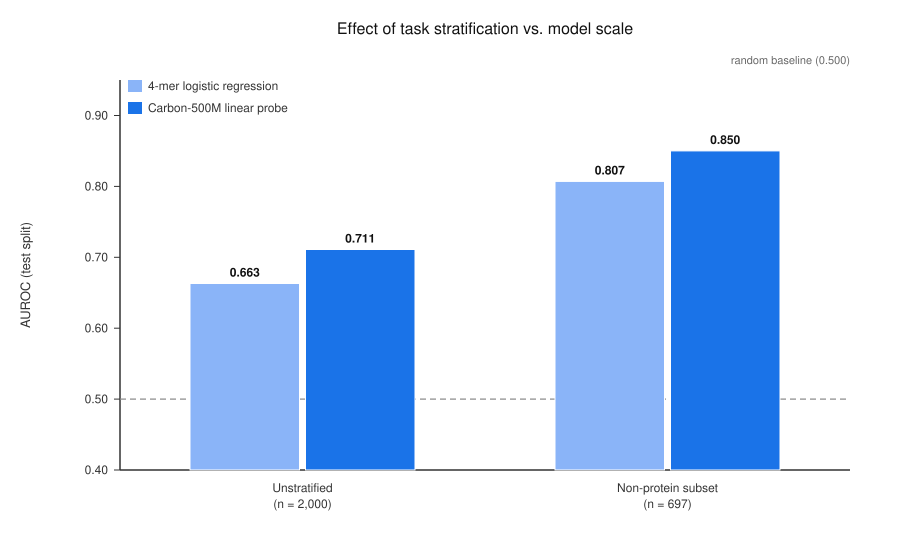
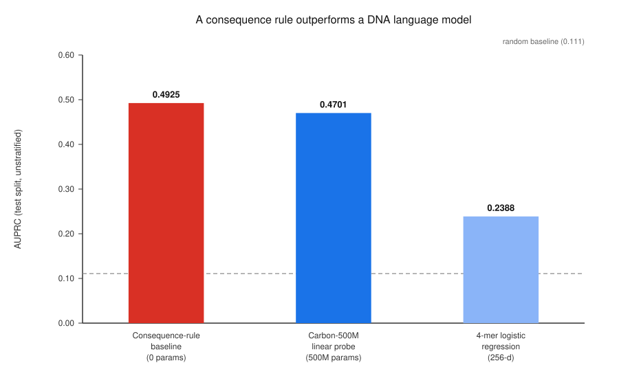

# ClinVar VEP 评测集的分布污染诊断与指标归因分析

**摘要**：在试跑 DNA 语言模型做变异效应预测（VEP）时，我怀疑通用 ClinVar 评测集存在
分子后果层面的分布污染，因此搭建了一条轻量诊断流水线，量化「按分子后果分层任务」与
「扩大模型规模」各自对指标的贡献。

---

## 主要发现

**1. 未分层集存在蛋白层面后果污染。**

在全量测试集上，**36.0% 的正例为无义（终止获得）变异，而负例中为 0.0%**。
本数据集只含**单碱基替换（SNV）**——SNV 不会产生移码，但可通过提前引入终止密码子造成蛋白截短。
这类变异的标签由蛋白层面后果决定；而模型输入是固定长度的裸基因组序列窗口，
**不含转录本结构与 CDS 阅读框信息**，无法从输入推算终止后果。
同时，这类变异用后果注释规则（VEP / SnpEff）即可直接筛出 ——
混入测试集后，基准不再反映**调控序列建模能力**。

> **直接证据**：一条不使用任何序列特征、仅依据 HGVS 后果标签的规则基线达到
> **AUPRC 0.4925**，高于训练过的 4-mer 逻辑回归模型（**0.2388**），
> 也高于 500M 参数的 Carbon-500M 线性探针（**0.4701**）。

**2. 任务分层对指标的贡献大于模型规模。**

- 同一模型（4-mer 逻辑回归）下，将任务过滤到非蛋白质层变异：AUROC 0.663 → **0.807（+0.144）**
- 同一任务下，将 4-mer 替换为 500M 参数 DNA 语言模型（Carbon）：0.807 → **0.850（+0.043）**

该增益在分层前后**几乎一致**（+0.048 vs +0.043），说明**模型规模是近似可加的改进，
无法补偿任务污染**。

**3. AUPRC 的绝对值不可跨数据集比较。**

其随机基线等于正例比例。以**「未分层集 → 非截断子集」**这一步为例：正例比例由 0.111 降至
0.074，同一模型的 AUROC 基本不变（0.663 → 0.678），但 AUPRC 绝对值反而由 0.239 降至 0.231；
而 AUPRC 相对随机基线的倍数却由 2.15× 升至 3.13×。**评测应同时报告 AUROC。**

---

## 方法要点

| 项 | 设置 |
|---|---|
| 数据 | ClinVar `variant_summary`，GRCh38，≥1 星评审，常染色体 SNV，P/LP vs B/LB |
| 筛选量 | 1,423,685 条 |
| 切分 | 按染色体硬切分：测试集 = 3, 6, 9, 12, 16, 18, 19, 21（与文献一致） |
| 样本 | 训练 4,000 / 测试 2,000，按自然正负比分层 |
| 序列 | 每条变异 ±100 bp（201 bp），来源 UCSC hg38 |
| 评分器 | 随机 / GC 含量 / 4-mer 上下文 / 4-mer 差分 / 后果规则基线 / Carbon-500M 探针 |
| 模型 | 逻辑回归（梯度下降，纯 NumPy 实现，无 scikit-learn 依赖） |

## 可复现性

数据已冻结并附 MD5 校验和；`python evaluate.py --all` 可一键复现全部结果。
构造脚本 `build.py` 可从头重建（约 30 分钟）。

## 定位说明

这是**评测诊断与归因分析（benchmark audit）**，**不是**一套新的工业级基准。
数据量小（6,000 条）、流程刻意保持轻量 ——
贡献在于**发现与归因**，不在规模。
